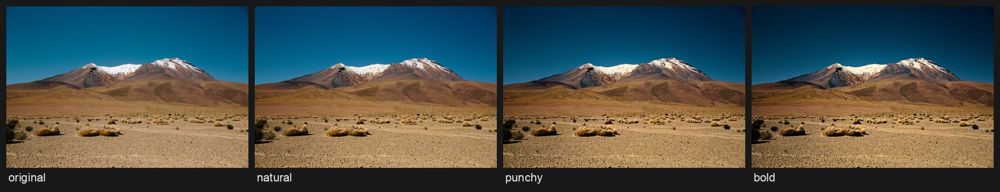

# photo-grade

Give your photos a natural, punchy or bold colour grade from the command line — with dehaze that adapts to each
photo, a filmic tone curve, 8-band HSL, colour wheels, per-region looks (sky, sand, water, foliage) and skin tones
that stay believable.

```bash
photo-grade holiday/ --preset punchy --before-after
```



## What it does

- **Three presets** — `natural`, `punchy`, `bold` — each a complete starting grade. `photo-grade presets` prints
  exactly what they set. `--preset none` starts from a gentle base look (a little contrast, vibrance and warmth);
  set `contrast`, `vibrance` and `warmth` to 0 in a settings file for no change at all.
- **Haze-aware dehaze.** A preset's dehaze is scaled by how hazy each photo actually is, so clear or indoor shots
  get almost none and hazy landscapes get the full amount. A dehaze value you set yourself is used as written.
- **Look:** contrast, vibrance (gentler on skin-coloured pixels), saturation, warmth, tint, shadows, highlights,
  black point, orange and blue controls, a filmic tone curve, 8-band HSL and shadow/midtone/highlight colour wheels.
- **Finish:** exposure, white balance, straighten (with automatic crop), denoise, dehaze, clarity, texture, sharpen,
  subject lift and edge burn, vignette and grain.
- **Region looks:** give the sky, sand, water, foliage or skin their own look, blended through soft masks found by
  colour and position. Experimental: with `"label": "food"` a food region finds the dish in the middle of the frame;
  with `"label": "sunset"` the warm and magenta parts of a sunset sky count as sky.
- Reads JPEG, PNG, TIFF and HEIC (iPhone) photos, converts wide-gamut colour (Display P3) to sRGB, and writes JPEG
  or 16-bit TIFF (the grade is computed and stored at higher precision; see Limitations). Folders work too (`--recursive` for sub-folders). Optional before/after previews.
- Runs entirely on your computer. No account, no uploads, no telemetry.

## Install

Needs Python 3.11 or newer. With [pipx](https://pipx.pypa.io/):

```bash
pipx install "photo-grade @ git+https://github.com/hassanitani6/photo-grade"
photo-grade doctor
```

Or from a clone with [uv](https://docs.astral.sh/uv/): `git clone …`, then `uv sync` and `uv run photo-grade …`.

## Quick start

```bash
photo-grade IMG_0042.heic                         # natural preset -> graded/IMG_0042_graded.jpg
photo-grade trip/ --preset bold -o trip-graded/   # a whole folder
photo-grade beach.jpg --settings my-look.json     # your own settings on top of a preset
photo-grade beach.jpg --format tiff16             # 16-bit TIFF for further editing
```

Originals are never modified: photo-grade refuses to write over any photo it reads (including a name that differs
only in upper/lower case, or a link to the same file), writes each output to a temporary file before renaming it, and
only replaces an existing output with `--overwrite`. If two photos would produce the same output name (say `a.jpg`
and `a.png`), nothing is graded until you separate them. Outputs inside the input folder are not graded again.

### Settings file

Anything you set overrides the preset key by key (nested settings like `curve` or an HSL band merge one level
deeper). See [`examples/settings.json`](https://github.com/hassanitani6/photo-grade/blob/main/examples/settings.json):

```json
{
  "preset": "punchy",
  "look": {"vibrance": 0.25, "hsl": {"blue": {"s": 0.05, "l": -0.08}}},
  "finish": {"exposure": 0.15, "vignette": 0.2},
  "regions": {"sky": {"contrast": 0.1, "blue_sat": 1.1}}
}
```

Every value is checked against its allowed range before anything is processed, and a wrong name or value is
reported in plain English.

## Limitations

- **No face detection.** Skin protection works by colour, so it still keeps skin tones natural, but the face-based
  tools (`finish.person`: face lift, skin smoothing, sharper eyes) need face positions and are ignored.
- **Graded files carry no camera metadata.** EXIF — including GPS location, camera model and capture date — is not
  copied to the output. That protects your privacy when sharing, but photo apps will sort graded files by the date
  they were created. JPEGs (and before/after previews) embed an sRGB profile; 16-bit TIFFs are sRGB without an
  embedded profile.
- Photos are read at 8 bits per channel, so a 16-bit TIFF holds the grade at higher precision but no extra detail
  from a 16-bit original. RAW camera files are not supported.
- HEIC support comes from pre-built `pi-heif` packages; on platforms without one (for example Windows on ARM) HEIC
  photos may not open — `photo-grade doctor` shows whether they do.
- Speed: about 10 s per 24-megapixel photo with a preset, 2 s without (measured on an Apple M5; other machines vary).
- The presets were tuned on sunny photos. On a white, overcast sky, `punchy` and `bold` add a cream cast (from their
  warm highlight colour wheel); use `natural`, or lower `grade.highlights.sat` in a settings file.
- Region masks are found by colour and position, so an orange car can pick up a "sand" look. Use region looks
  gently, and check the before/after.

## Troubleshooting

| Symptom | Try |
|---|---|
| `already exists (use --overwrite …)` | Choose another `--out-dir`/`--suffix`, or add `--overwrite`. |
| HEIC files are skipped | Run `photo-grade doctor`; `heic_support` should say `ok`. If it does, the file itself is unreadable. |
| A setting is rejected | The message names the setting and its allowed range, or lists the allowed names if the name is unknown. |
| `would both write …` | Two photos share a name; grade them separately or use different `--out-dir` folders. |
| A file called `doctor` or `presets` | Write `./doctor` so it isn't taken as a command. |
| The grade looks too strong | Start from `--preset natural`, or lower `vibrance`, the `curve` strength and `dehaze` in a settings file. |

## Privacy

photo-grade never uploads anything and never contacts the internet. Its own output drops your photos' location and
camera data. If you report a problem, `photo-grade doctor` prints an environment report with your user name and
home folder removed — check it before pasting. Photos you attach to a public issue keep their own metadata, so share
only test photos you're happy to make public.

## Contributing

Bug reports, test photos you can share, and pull requests are welcome — see [CONTRIBUTING.md](https://github.com/hassanitani6/photo-grade/blob/main/CONTRIBUTING.md).
Security problems: [SECURITY.md](https://github.com/hassanitani6/photo-grade/blob/main/SECURITY.md).

## Credits

Dehaze uses the dark-channel prior (He, Sun & Tang, 2009) refined with a guided filter (He, Sun & Tang, 2010);
the food-region saliency uses the spectral residual method (Hou & Zhang, 2007). These are independent
implementations of the published methods.

Demo photo: "A snowy mountain in the desert" by Pablo Garcia Saldaña, CC0, via
[Wikimedia Commons](https://commons.wikimedia.org/wiki/File:A_snowy_mountain_in_the_desert_%28Unsplash%29.jpg).

## Licence

MIT — see [LICENSE](https://github.com/hassanitani6/photo-grade/blob/main/LICENSE).
